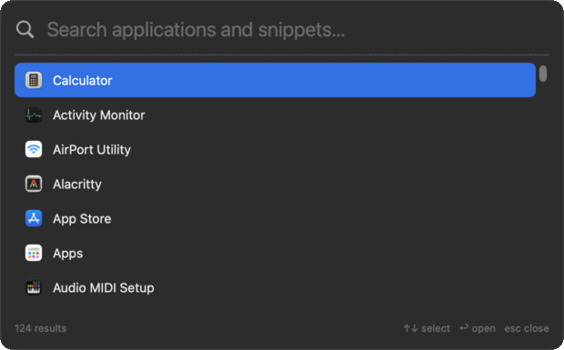

# heycast

A menu-bar launcher for everyday Mac work: one shortcut opens apps, pastes
snippets and snaps windows. Small, native, local-first — plain files, no
account, no telemetry.



## What it does

- **Launch apps.** Press `⌥Space`, type a few letters, hit `↩`. The palette
  reads `/Applications`, `/System/Applications` and `~/Applications`, and
  rescans every time it opens, so an app installed a minute ago is there.
- **Paste snippets.** `⌥⇧Space` searches snippets only. Snippets are Markdown
  files with a keyword; type the keyword in any app to expand it in place, or
  pick it from the palette. `{date}`, `{time}`, `{clipboard}` and `{uuid}`
  fill in at paste time, and your previous clipboard comes back afterwards.
- **Arrange windows.** `⌃⌥` plus an arrow snaps the focused window to that
  half, `⌃⌥↩` maximizes and `⌃⌥C` centers it.
- **Stay out of the way.** Menu bar only: no Dock icon, no main window, no
  queue of notifications.

## Install (30 seconds)

Requires macOS 14 or later on Apple silicon, and Homebrew 7 or later.

```sh
brew trust ernilambar/tap
brew install --cask ernilambar/tap/heycast
```

Both commands are required. Homebrew 7 refuses an untrusted tap, so the
one-line install fails on a fresh machine. The cask removes the download
quarantine flag; the app is not notarized and `spctl` rejects it by design, so
the tap is the only supported install. There is no zip download.

Upgrade with `brew upgrade --cask heycast`. Remove the app and its files with
`brew uninstall --zap --cask heycast`.

## Use

- `⌥Space` toggles the palette from any app.
- `⌥⇧Space` opens the palette with snippets only.
- `⌃⌥` plus an arrow fills that half of the screen, `⌃⌥↩` maximizes and
  `⌃⌥C` centers the focused window. All shortcuts are configurable; see
  [docs/keymaps.md](docs/keymaps.md).
- Click the menu-bar item to toggle the palette.
- Right-click the menu-bar item for Settings, "Launch at Login",
  "Permissions…", the Window submenu and "Edit Config…".
- `↑`/`↓` moves the selection, `↩` launches the selected app or pastes the
  selected snippet, clicking a row does the same, `esc` or focusing another app
  closes the palette.
- Typing a snippet keyword in any app expands it in place; this needs
  Accessibility.

## Settings

Settings edits `config.json` for you: record a shortcut, choose the snippets
folder, and turn Launch at Login on or off. Changes save atomically and apply
immediately — the new shortcut works and the new snippets folder is read
without relaunching. "Edit Config…" still opens the same file for keys that
have no UI.

All app files live in `~/Library/Application Support/net.nilambar.heycast/`.

```json
{
  "keymaps": {
    "palette": "alt+space",
    "snippets": "alt+shift+space"
  },
  "snippetsDirectory": "~/Documents/heycast-snippets"
}
```

- `keymaps`: global shortcuts. An empty string disables an action. See
  [docs/keymaps.md](docs/keymaps.md).
- `snippetsDirectory`: snippets folder. See
  [docs/snippets.md](docs/snippets.md#location).

## Search

Type to filter apps in `/Applications`, `/System/Applications` and
`~/Applications`, plus snippets. Frequently and recently launched apps rank
higher, and the catalog is rescanned on every palette open. Details:
[docs/search.md](docs/search.md).

## Snippets

A snippet is a Markdown file in the snippets folder: a `keyword` in the front
matter, then the text to paste. Set `type: script` or `script: <path>` to paste
a script's output instead. Full reference: [docs/snippets.md](docs/snippets.md).

```markdown
---
keyword: ;sig
name: Email signature
---

Best regards,
Nilambar Sharma
```

## Permissions

Heycast asks for one grant: **Accessibility**. It powers snippet pasting and
expansion (Heycast types on your behalf) and moving or resizing other apps'
windows. Global hotkeys and app launching need no grant.

Nothing is requested at launch: the setup window opens the first time you use
a snippet or a window command, and "Permissions…" reopens it at any time.
Launch at Login is a separate toggle in Settings and the menu-bar item.

## License

[MIT](LICENSE) © 2026 [Nilambar Sharma](https://www.nilambar.net)
