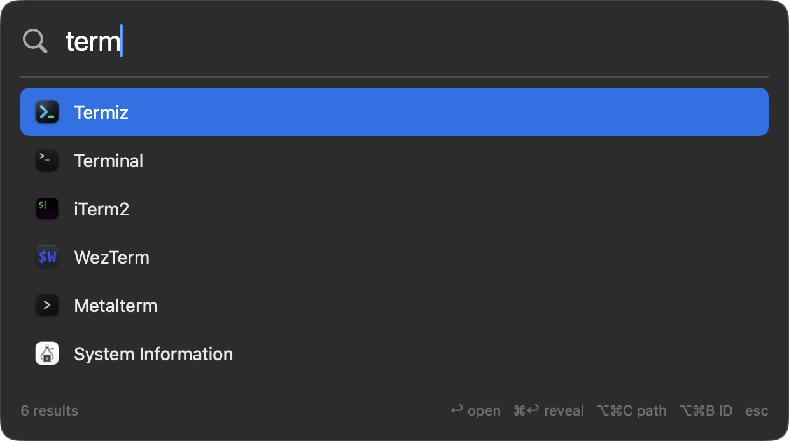

# heycast

A menu-bar launcher for everyday Mac work: one shortcut opens apps, pastes
snippets and snaps windows. Small, native, local-first — plain files, no
account, no telemetry.



## What it does

- **Launch apps.** `⌥Space`, a few letters, `↩`. Reads `/Applications`,
  `/System/Applications` and `~/Applications` and rescans on every open.
- **Paste snippets.** `⌥⇧Space` filters snippets only. Type a keyword in any
  app to expand it in place, or pick it from the palette.
- **Arrange windows.** `⌃⌥` plus an arrow snaps a half, `⌃⌥↩` maximizes,
  `⌃⌥C` centers.

## Install

Requires macOS 14+ on Apple silicon and Homebrew 7+.

```sh
brew trust ernilambar/tap
brew install --cask ernilambar/tap/heycast
```

Both commands are required: the app is not notarized, and the tap is the only
supported install. Upgrade with `brew upgrade --cask heycast`; remove
everything with `brew uninstall --zap --cask heycast`.

## Use

- Click the menu-bar item to toggle the palette; right-click for Settings,
  "Permissions…" and the Window submenu.
- `↑`/`↓` moves, `↩` opens the selected app, pastes the snippet or runs the
  command, `esc` closes. On a row, `⌘↩` reveals the file, `⌥⌘C` copies its
  path, `⌥⌘B` copies an app's bundle identifier.
- Type `Sleep`, `Open Permissions` or `Open Config` to run a built-in command.
- All shortcuts are configurable; see [docs/keymaps.md](docs/keymaps.md).
  Search ranks frequent and recent apps higher; see [docs/search.md](docs/search.md).

## Snippets

A snippet is a Markdown file with a `keyword` in the front matter and the text
to paste below. `{date}`, `{time}`, `{clipboard}` and `{uuid}` fill in at paste
time; the previous clipboard is restored afterwards. Use `type: script` or
`script: <path>` to paste a script's output instead. Full reference:
[docs/snippets.md](docs/snippets.md).

```markdown
---
keyword: ;sig
name: Email signature
---

Best regards,
Nilambar Sharma
```

## Settings

Settings records shortcuts, picks the snippets folder and turns Launch at Login
on or off. Changes apply immediately. "Edit Config…" opens `config.json` for
keys without a UI.

All files live in `~/Library/Application Support/net.nilambar.heycast/`; the
only config keys so far are `keymaps` (empty string disables an action) and
`snippetsDirectory`.

## Privacy

No telemetry: Heycast makes no network calls — no analytics, crash reporting,
install ID or account. Script snippets run only the code you wrote, including
any network access it contains.

## Permissions

One grant: **Accessibility**, for pasting/expanding snippets and moving other
windows. It is requested lazily on first snippet or window use, never at
launch; "Permissions…" reopens the setup window.

## License

[MIT](LICENSE) © 2026 [Nilambar Sharma](https://www.nilambar.net)
